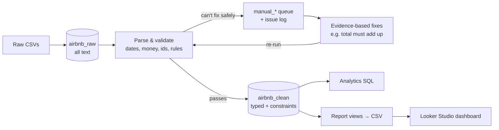

  

  

## 👨‍💼 About Me

I'm a finance and payroll professional from Kaunas, Lithuania, in the middle of a career move into data analytics and data science. I have a Master's in Accounting and Audit and a Bachelor's in Economics and Finance, and I've spent several years working with numbers at Deloitte Lithuania, NKT and Nordgain. Over time I realised that the part of the job I enjoyed most wasn't closing the books. It was digging into the data behind them.

At Deloitte I handled payroll for many clients, and at NKT I worked as a Senior Accounts Receivable Accountant. Both jobs taught me how much a business depends on accurate, well-structured data. Every month meant reconciling large datasets, chasing down mismatches, and checking that every figure followed Lithuanian tax and labour rules (GPM, NPD, Sodra, VDU). That's where I built the habits that matter most in analytics: attention to detail, a healthy distrust of messy data, and a need to understand why a number is what it is.

Now I'm turning that experience into technical skills. I write **SQL** for data cleaning, exploratory analysis and business KPIs, including window functions, CTEs, stored procedures, triggers and events. In **Python** I work with pandas, NumPy and Matplotlib, and I'm learning Streamlit to build interactive data apps. I use **R** for data cleaning pipelines and R Markdown reporting, and I build dashboards in **Power BI** (DAX, Power Query) and **Excel**.

What sets me apart is that I understand both sides: the data and the business it describes. I know what a finance team needs from a report, which numbers management actually looks at, and how small data errors turn into real financial problems. My goal is to be an analyst who doesn't just produce charts but helps people make better decisions with clean, trustworthy data.

This GitHub is my learning journal and portfolio. Each project below takes a real-world dataset from raw to insight: cleaning, analysis, visualisation and clear conclusions. I'm currently going deeper into data science with Python and R, and I'm **open to data analyst / data scientist opportunities**. Feel free to reach out on LinkedIn or by email!

  
  

---
 
## 🛠️ Tools & Skills

  &nbsp;&nbsp;
  &nbsp;&nbsp;
  &nbsp;&nbsp;
  &nbsp;&nbsp;
  &nbsp;&nbsp;
  

  &nbsp;&nbsp;
  &nbsp;&nbsp;
  &nbsp;&nbsp;
  &nbsp;&nbsp;
  &nbsp;&nbsp;
  

---
 
## 📂 Projects

### 🛒 Amazon Sales Performance Analysis (2021–2025)
 

End-to-end sales analysis of an Amazon-style marketplace covering five years of trading. I built a full analytics pipeline across 16 related tables and ~680k rows, from data loading and cleaning through KPI modelling to a 5-page executive dashboard. The analysis tracks revenue growth from **$3.0M to $5.4M**, category mix shifts, customer retention, marketing ROI and delivery performance, and closes with data-driven business recommendations.
 
**Focus areas:** Sales KPIs · Customer Retention · Marketing ROI · Fulfilment & Returns
 

---

### 🏠 Airbnb Rentals Analysis (2022–2025)

Data cleaning pipeline and analysis for a short-term rental marketplace in London, Paris, Barcelona and Amsterdam. The source data (9 related tables, ~300k rows) came in dirty: mixed date formats, prices with the wrong currency sign or 100x too big, swapped coordinates, duplicate guests, totals that didn't add up and orphan references. I built a MySQL pipeline that loads everything as raw text, parses and validates every value, repairs what the data itself can prove, and routes the rest to a manual review queue instead of guessing. Only rows that pass every check reach the clean database, which went from **278K to 291K** clean rows after review. On top of it sits the analysis of **€48.65M** in revenue and a 4-page Looker Studio dashboard.

**Focus areas:** Data Cleaning & Validation · Revenue & Occupancy · Host Performance · Pricing & Reviews

---

 

---
 

